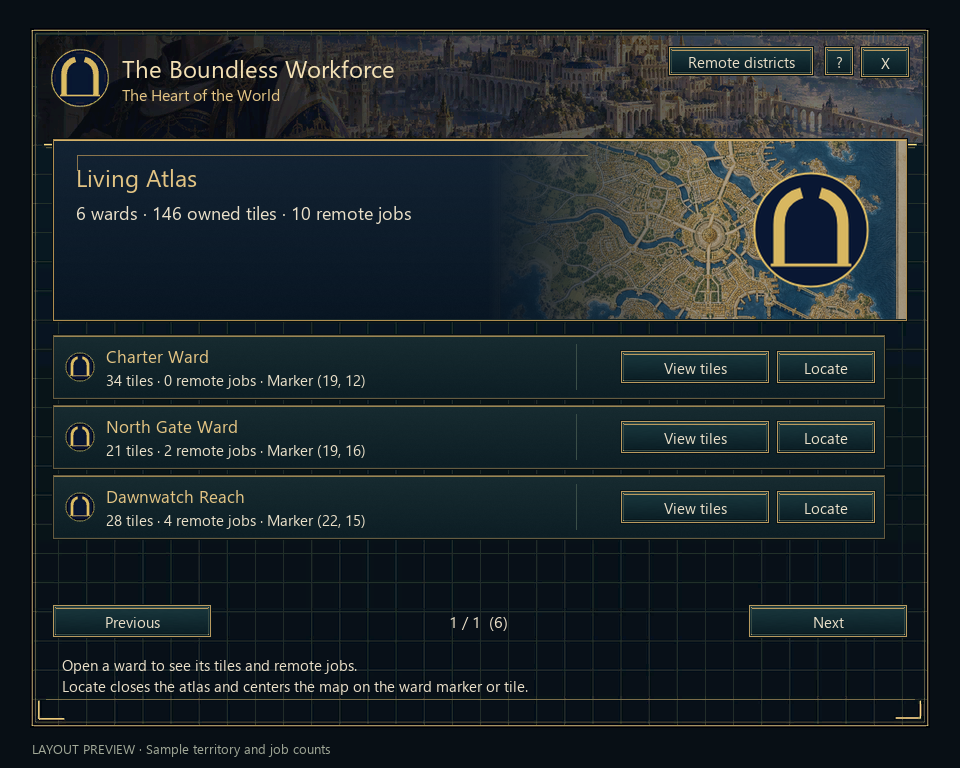

# Living Atlas

Open **The Boundless Workforce → Living Atlas**. Charter Ward covers the area within three hexes of the original capital. Eight named wards chart the surrounding territory by compass direction, including across wrapped map edges. The map marker for each ward is its nearest owned tile to the capital.

**View tiles** opens a ward register with active remote jobs first. The ward header displays the gross yields already credited for those jobs. Individual job tooltips show the same yield breakdown for the tile. **Locate** returns to the map and centers the selected tile or ward marker.

The split arch appears on the Workforce launcher and in the atlas. Frontier Surveyors have their original compass pennant on the map. Ward geography and job totals are derived from the existing map and Workforce ledger when the atlas is opened. An existing campaign can use the atlas as soon as the mod loads.

New frontier Culture claims and native Culture border gains each get a notification with the tile's coordinates, direction, distance, and ward. Clicking the entry centers the claimed tile. The Community Patch reports native cultural acquisitions through `CityBoughtPlot` and uses a plot-targeted click action for ordinary notifications. [Cultural acquisition source](https://github.com/LoneGazebo/Community-Patch-DLL/blob/dcb33a654cd9e8efb038a0733b4025e19cbcd8ba/CvGameCoreDLL_Expansion2/CvCity.cpp#L16072-L16165) · [Notification activation source](https://github.com/LoneGazebo/Community-Patch-DLL/blob/master/CvGameCoreDLL_Expansion2/CvNotifications.cpp#L1067-L1077).

The preview uses the shipped DDS textures and sample data. Native font rendering, notifications and camera jumps can be checked by opening a ward, locating one of its tiles, and then clicking the next **Border expanded** alert in Civ V.
