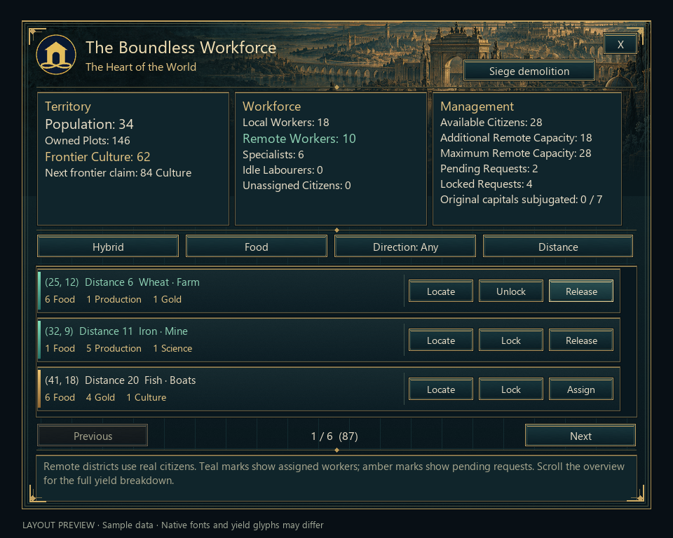

# Boundless Workforce artwork

Original custom interface artwork, created on 2026-10-24 for the Boundless City. The palette follows the civilization's gold emblem and dark civic architecture.



The preview uses the shipped DDS textures and XML positions, with sample data and approximate Windows fonts. It is not a screenshot from Civ V. Its labelled yield counters stand in for the game's native yield glyphs.

## Sources and regeneration

`EngravedCity.png` is the original 2172×724 illustration produced with the **built-in image_gen tool**. The exact request is saved in [EngravedCity.prompt.txt](EngravedCity.prompt.txt). No CLI/API fallback or external artwork was used. The original generated file is retained; the repository copy is the build source.

`BC_UI_*.png` are lossless masters compiled by `tools/prepare_boundless_ui.py`. Precise rims, materials, corner ornaments, row backgrounds and button states are drawn deterministically. The city painting is composited into the panel header; text and live statistics remain native controls.

| Texture | Pixels | Purpose |
| --- | --- | --- |
| BC_UI_Panel | 900×700 | City header, brass frame, three summary wells, district and help wells |
| BC_UI_Launcher | 245×36 | Matching world-map launcher frame |
| BC_UI_Row | 834×66 | Readable district row with separate action area |
| BC_UI_Buttons | 64×256 | Four 44×44 native button states at y=0/45/90/135 |
| BC_UI_Assigned | 4×54 | Teal assigned/ready mark |
| BC_UI_Pending | 4×54 | Amber pending-request mark |

Run from the repository root:

```powershell
python tools/prepare_boundless_ui.py
python tools/preview_boundless_ui.py
python tools/build_mod.py --manifest-only
python tools/validate_summary.py
```

Compilation writes legacy uncompressed RGBA DDS files with full mip chains into `TheBoundlessCity/Art`. The six textures use about 3.8 MB on disk; repeated rows reuse the same assets. The existing collection atlas finisher does not alter these interface textures.

The native nine-slice geometry comes from the installed game's `Assets/UI/Styles.xml`, `Grid9FrameButtons`: 8/28/8 slices, 44px cell extent and 45px state stride. Each button supplies its own GridData texture; no global style or vanilla texture is replaced. Hover, pressed and disabled rendering still require the native check in [UIVisuals.md](../../../TheBoundlessCity/docs/UIVisuals.md).
