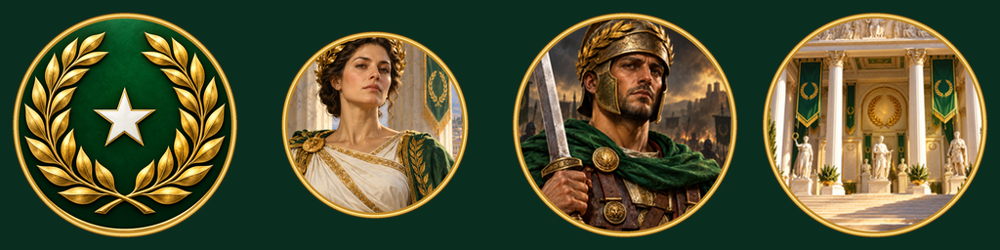

# Laureate Commonwealth artwork

Five original paintings generated with the built-in **image_gen** tool on 2026-10-30:

- `CivIcon.png`: gold laurel, white star, emerald medallion.
- `Laurea.png`: Keeper of the Unfading Crown; source for diplomacy and cropped leader portrait.
- `Champion.png`: classical veteran in practical armor.
- `Hall.png`: marble Hall of Laurels, statues, wreaths and commemorative banners.
- `Daphne.png`: civic celebration, veterans, scholars and green/gold banners; separate Dawn of Man painting.

[Prompts.json](Prompts.json) preserves the complete prompt set and tool identity. No reference artwork was copied. Generated source PNGs are retained without alteration.

`tools/prepare_laureate_art.py` mechanically crops/resizes the paintings, applies the repository's existing circular framing and writes legacy RGBA DDS with complete mip chains. It also draws original code-native white wreath/star alpha, sword/wreath unit flag and fictional cartographic loading map. These are finished symbolic assets. The Swordsman 3D model and animations remain native.

`Portrait.png`, `Objects.png`, `Icon.png` and `Alpha.png` are derived masters; `Preview.png` shows the framed four portrait cells. Three unframed color atlas masters are retained in `../IconAtlasMasters/LC_*.png`. The game folder contains 40 DDS textures: four atlas families at nine sizes (16, 24, 32, 45, 48, 64, 80, 128, 256), a 32px unit flag, 1600×900 leader, 1024×768 Dawn and 512×512 map. The static leader XML references the real exported leader image.

No remaining external art dependencies. Native texture/diplomacy/loading display is listed in the game's acceptance checklist.

