# Cool Wacky Civs 2 civilization gallery

[Collection README](../README.md) · [Installation](../README.md#playing-the-mod) · [Artwork credits](artwork/README.md)

Select a civilization to read its guide. Each preview shows the leader’s diplomacy artwork.

<table>
  <tr>
    <td width="33%" valign="top">
      <a href="../TheBoundlessCity/README.md">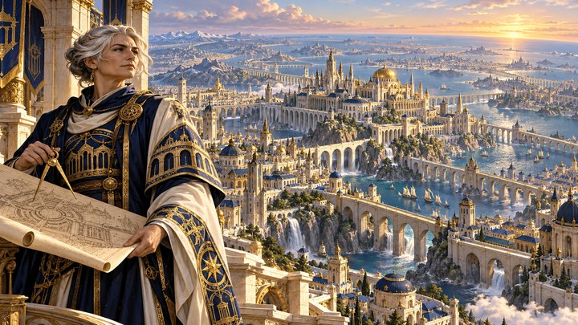 <strong>The Boundless City</strong></a> 
      The First Architect 
      One expanding municipality with a finite workforce
    </td>
    <td width="33%" valign="top">
      <a href="../TheRepublicOfPigeons/README.md">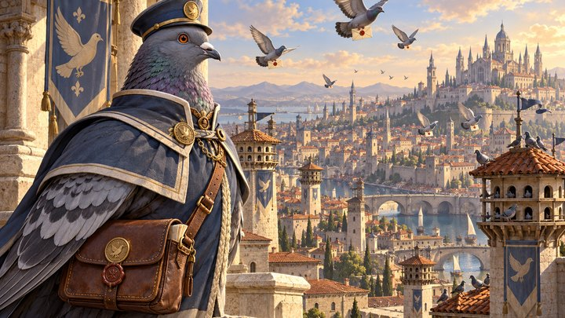 <strong>Pigeon Republic</strong></a> 
      Postmaster General Coo 
      Protected land trade and distributed origin-city yields
    </td>
    <td width="33%" valign="top">
      <a href="../TrainerRed/README.md"> <strong>Indigo Champion</strong></a> 
      Trainer Red 
      An irreplaceable veteran team and selected tactical tools
    </td>
  </tr>
  <tr>
    <td width="33%" valign="top">
      <a href="../McPvP/README.md">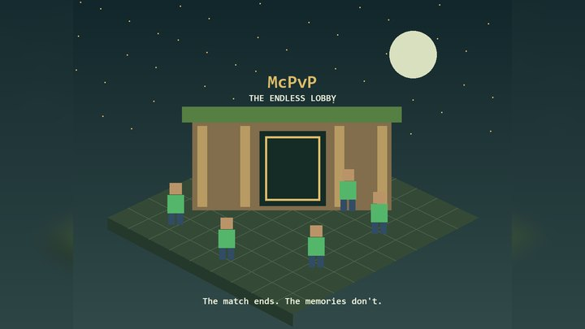 <strong>McPvP</strong></a> 
      The Old Guard 
      Objective warfare, mobility and persistent Server Legacy
    </td>
    <td width="33%" valign="top">
      <a href="../TheChildrenOfTheKingdom/README.md"> <strong>Children of the Kingdom</strong></a> 
      The Faithful 
      A fixed prayer cycle with permanent capital development
    </td>
    <td width="33%" valign="top">
      <a href="../TheTwelfthHour/README.md">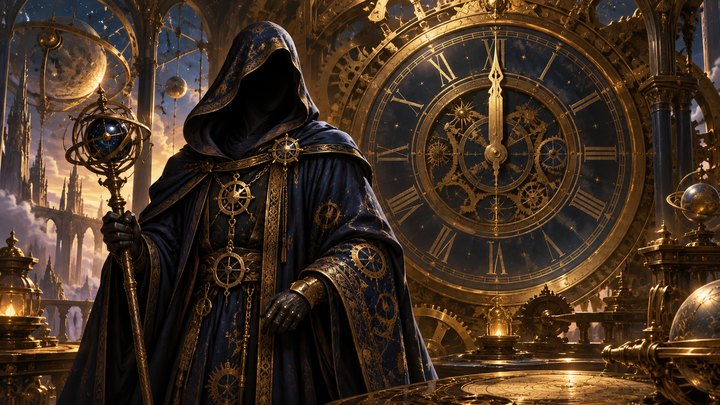 <strong>The Twelfth Hour</strong></a> 
      The Keeper of Seconds 
      Developed-city industry and a synchronized six-turn economy
    </td>
  </tr>
  <tr>
    <td width="33%" valign="top">
      <a href="../TheWanderingCircus/README.md">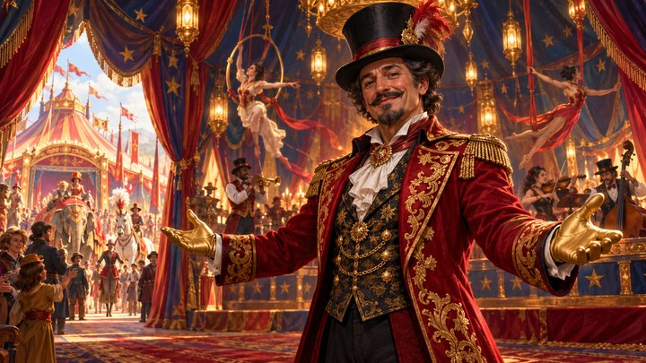 <strong>The Wandering Circus</strong></a> 
      Ringmaster Aurelio 
      Worker logistics and recurring local cultural festivals
    </td>
    <td width="33%" valign="top">
      <a href="../The11Cats/README.md"> <strong>The 11 Cats</strong></a> 
      Austin 
      Peaceful city specialization through a persistent household
    </td>
    <td width="33%" valign="top">
      <a href="../KingdomOfSaba/README.md">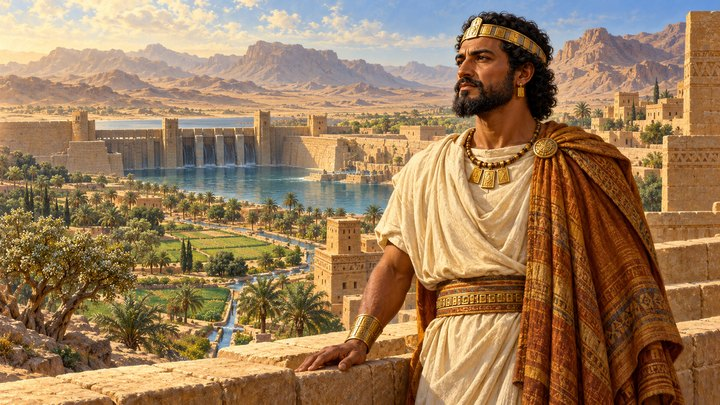 <strong>Saba</strong></a> 
      Karib&#x27;il Watar 
      Low-management River settlement and practical early defense
    </td>
  </tr>
  <tr>
    <td width="33%" valign="top">
      <a href="../TheSubstituteClassroom/README.md"> <strong>Substitute Classroom</strong></a> 
      Mr. Garvey 
      Timed economic choices with a risky combat surge
    </td>
    <td width="33%" valign="top">
      <a href="../TheConicalUnion/README.md">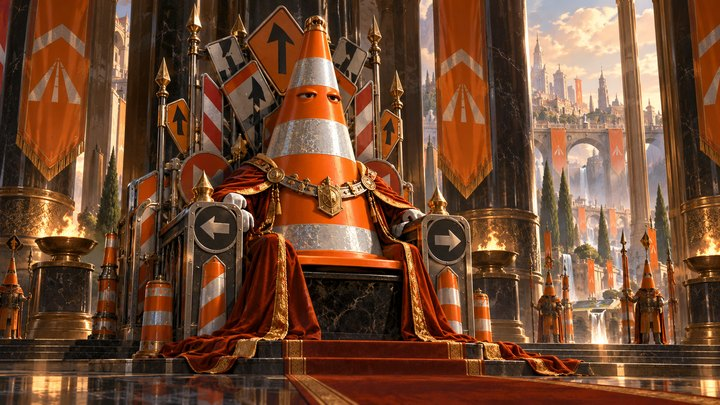 <strong>The Conical Union</strong></a> 
      High Marshal Bollard 
      Connected secondary cities and efficient worker logistics
    </td>
    <td width="33%" valign="top">
      <a href="../KingdomOfTheUnrungBell/README.md"> <strong>Unrung Bell</strong></a> 
      Keeper Sable 
      Peaceful accumulation followed by a limited territorial response
    </td>
  </tr>
  <tr>
    <td width="33%" valign="top">
      <a href="../TheUrgal/README.md">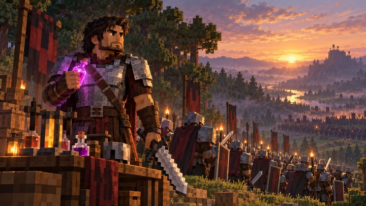 <strong>The Urgal</strong></a> 
      Urgal 
      Snapshot-based melee timing attacks
    </td>
    <td width="33%" valign="top">
      <a href="../JinDynasty/README.md">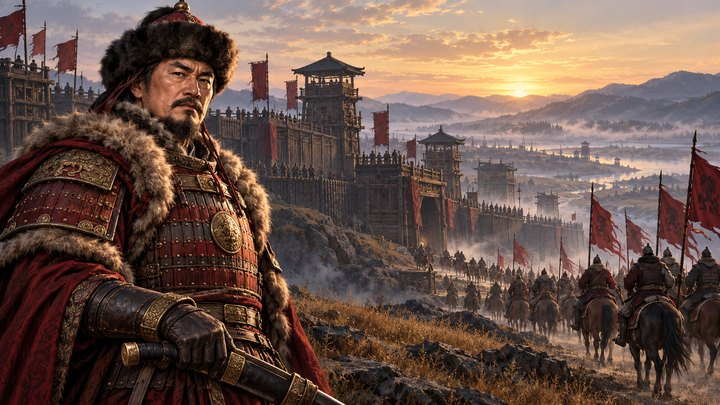 <strong>Jin</strong></a> 
      Wanyan Aguda 
      Resource-backed cavalry, selected landmarks and tributary logistics
    </td>
    <td width="33%" valign="top">
      <a href="../TheThresholdCourt/README.md">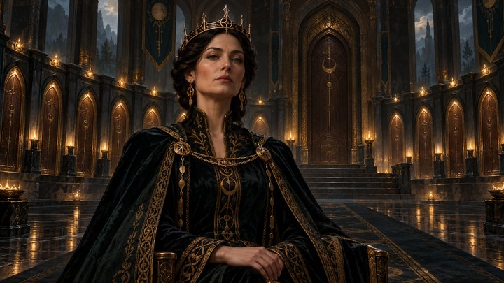 <strong>The Threshold Court</strong></a> 
      Queen Elsewhere 
      A paid defensive reinforcement network between owned cities
    </td>
  </tr>
  <tr>
    <td width="33%" valign="top">
      <a href="../TheHoneycombCommonwealth/README.md">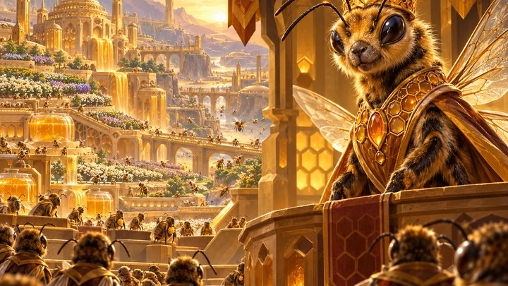 <strong>Honeycomb Commonwealth</strong></a> 
      Speaker Mellia 
      Worked-Plantation specialization and protected agrarian development
    </td>
    <td width="33%" valign="top">
      <a href="../TheLaureateCommonwealth/README.md">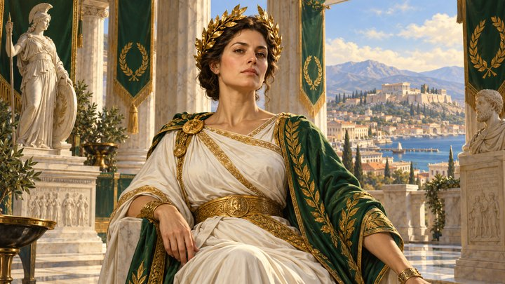 <strong>Laureate Commonwealth</strong></a> 
      Laurea 
      Achievement-fed Golden Ages and cultured military finishing
    </td>
    <td width="33%" valign="top">
      <a href="../T1ZOFGK/README.md">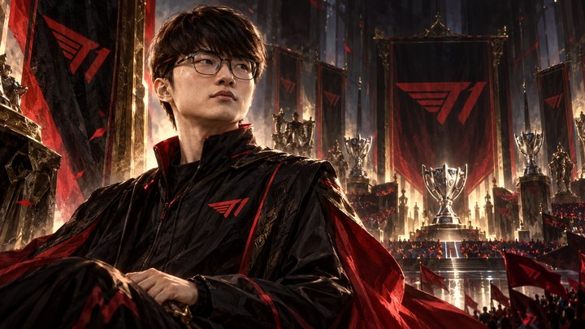 <strong>T1</strong></a> 
      Faker 
      Five persistent roles and long-lived upgrade development
    </td>
  </tr>
  <tr>
    <td width="33%" valign="top">
      <a href="../TheRepublicOfFirstDrafts/README.md"> <strong>The Republic of First Drafts</strong></a> 
      Editor-in-Chief Marginalia 
      Institutional variety and permanent first-possession rewards
    </td>
    <td width="33%" valign="top">
      <a href="../TheLanternFleet/README.md"> <strong>The Lantern Fleet</strong></a> 
      High Keeper Maren 
      Defensive coastal development and turn-start naval snapshots
    </td>
    <td width="33%" valign="top">
      <a href="../TheTriumphalImperium/README.md">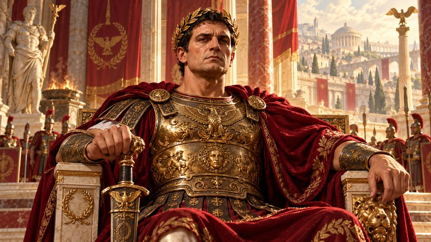 <strong>The Triumphal Imperium</strong></a> 
      Imperator Aurelion 
      Earned Victory Momentum, military mobilisation and relentless offensives
    </td>
  </tr>
  <tr>
    <td width="33%" valign="top">
      <a href="../TheCovenant/README.md"> <strong>The Covenant</strong></a> 
      The Scribe 
      Scripture recall, spaced reviews and recurring exams
    </td>
    <td width="33%"></td>
    <td width="33%"></td>
  </tr>
</table>
